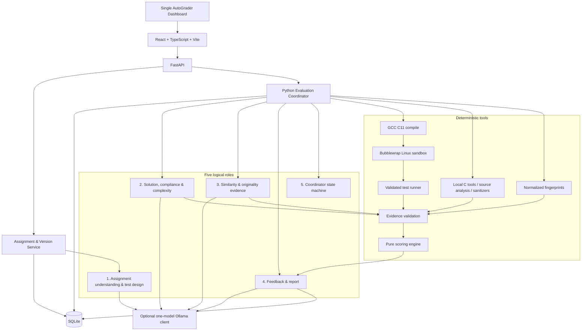

# AutoGrader architecture

AutoGrader is a local-first modular monolith. The API, durable coordinator,
typed evidence model, deterministic scoring engine, and React dashboard live in
one repository and one SQLite-backed application. Student C source is treated
as hostile input and is never executed in the FastAPI process or directly on
the host.

## Boundary responsibilities

- **API:** validates requests, persists durable objects, exposes polling and
  download routes, and never accepts a client path as a host filesystem path.
- **Assignment service:** validates instructor rules, calculates a stable hash,
  stores immutable versions, and blocks activation when score-affecting test
  oracles are not validated.
- **Coordinator:** owns legal evaluation transitions, progress, retries and
  partial-failure classification. It is role 5, not an LLM worker.
- **Sandbox adapter:** exposes a typed interface with a real Bubblewrap runner,
  an optional Docker adapter and a deterministic fake. The default Bubblewrap
  runner fails closed if the Linux namespace tool or GCC is unavailable.
- **Evidence layer:** stores tool observations and concise reasoning with source
  type, status, provenance and links to tests/criteria.
- **Scoring engine:** pure Python, no network or model calls, and no ability for
  model output to change weights or assign arbitrary points.
- **Dashboard:** one operator-facing workspace with assignment setup, upload,
  results, investigation, similarity review and health pages.

## Persistence

SQLite tables represent assignments, immutable versions, validated test cases,
batches, submissions, evaluation runs, evidence, scores, reports, similarity
findings and audit events. Source and report artifacts remain under the
configured application artifact directory; no public static route exposes them.
