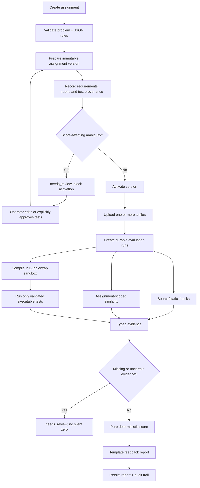

# Evaluation flow

The UI reads persisted run and audit events through
`GET /api/batches/{id}/live`. While a run is active it shows the current stage,
the next stage, per-submission progress and recent activity. The production
Linux path uses the real Bubblewrap runner; the fake runner is limited to
automated tests.

## Run states

`queued → preparing → compiling → testing → analyzing → validating_evidence →
scoring → reporting → completed` is the normal path. `needs_review`, `failed`,
and `cancelled` are explicit terminal or operator-action states. Illegal
transitions are rejected by the state machine and covered by unit tests.

## No-reference-solution policy

AutoGrader does not request, generate, or compare against a hidden reference
program. Executable expected output must come from an instructor-provided
example/rule or another explicitly justified, validated oracle. A behavior-only
candidate or an unverified model proposal cannot affect a score. If an
assignment is underspecified, the version remains visible as needing review.
